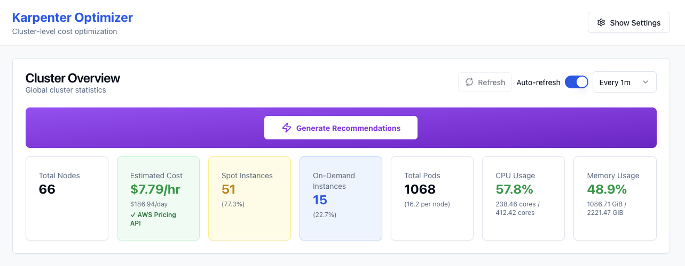
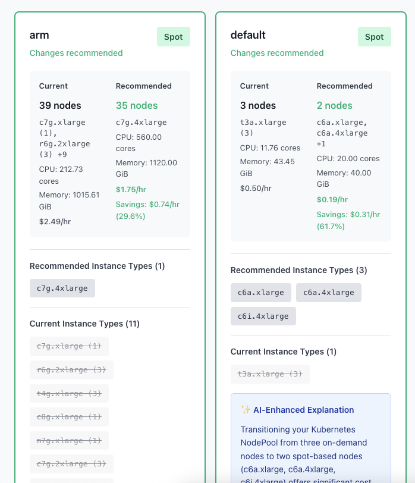
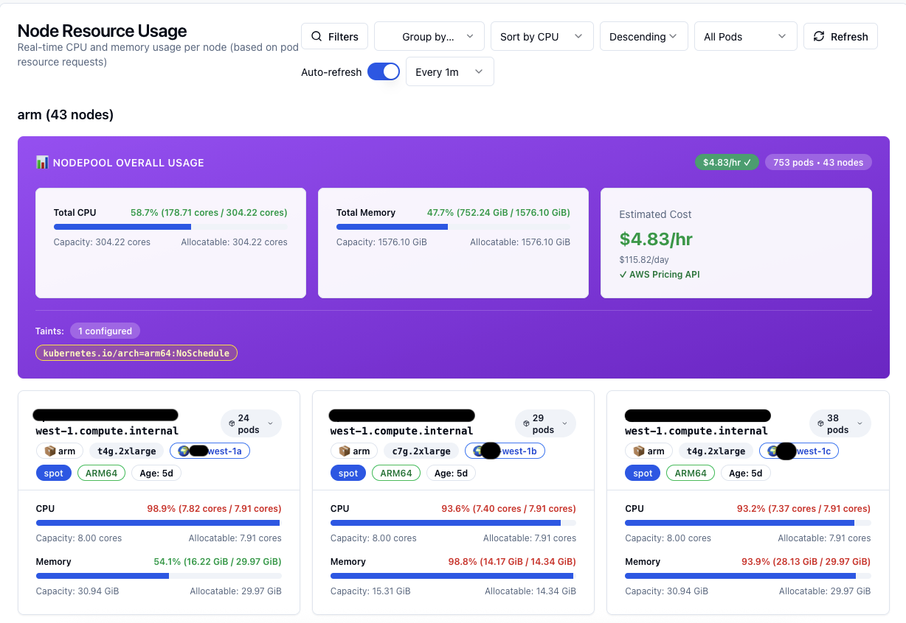
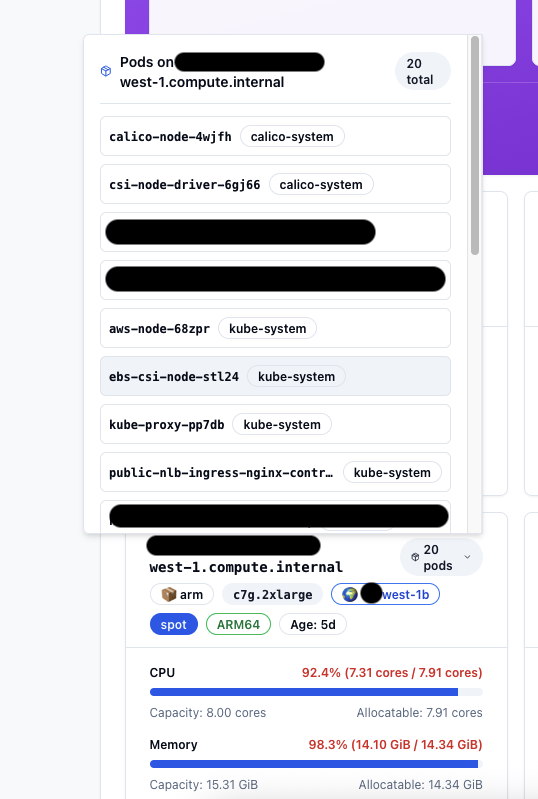
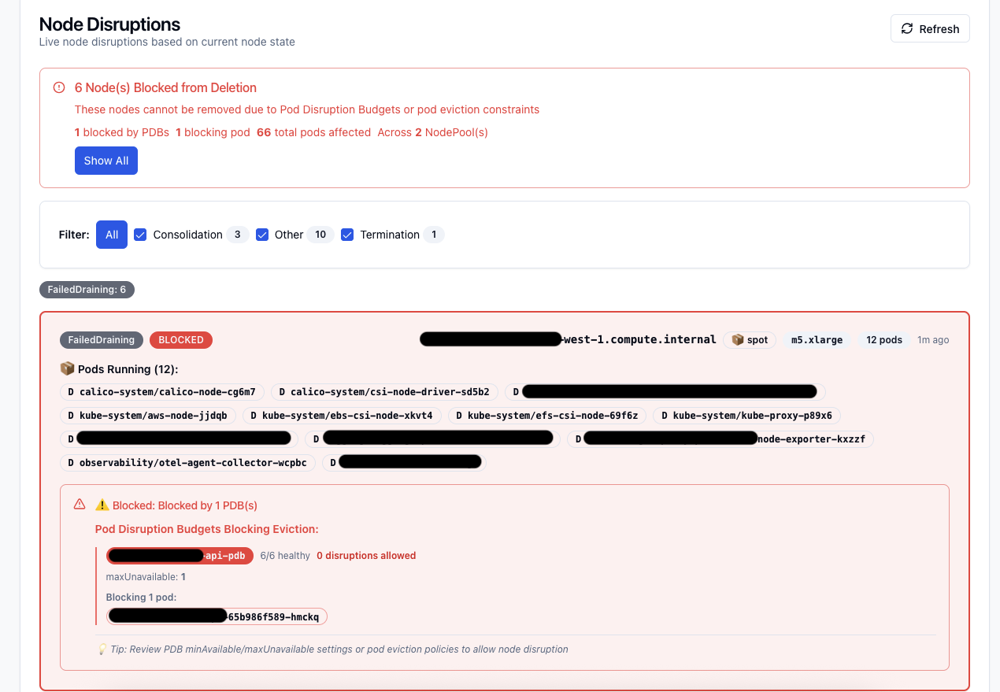
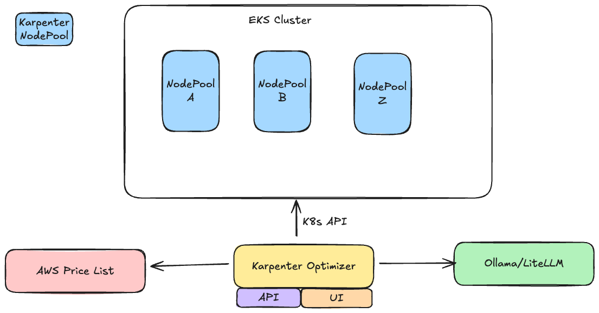

# Karpenter Optimizer

[](LICENSE)
[](https://goreportcard.com/report/github.com/kaskol10/karpenter-optimizer)
[](https://github.com/kaskol10/karpenter-optimizer/actions)
[](https://github.com/kaskol10/karpenter-optimizer/releases)

💰 **Cost optimization tool for Karpenter NodePools**. Analyzes Kubernetes cluster usage and provides AI-powered recommendations to reduce AWS EC2 costs while maintaining performance.

Karpenter Optimizer helps you optimize your Karpenter NodePool configurations by analyzing actual cluster usage and providing intelligent, cost-effective instance type recommendations. Get visual before/after comparisons showing cost and resource savings.

## ✨ Features

- 🎯 **Automatic Workload Discovery**: Automatically fetch workloads from your Kubernetes cluster
- 📈 **Cluster Trends**: CPU, memory, GPU-memory and estimated-cost trend sparklines in the Cluster Overview (1h/6h/24h) from a background sampler; per-node age badges in the Topology view
- 📊 **Real-time Node Usage**: Visualize actual CPU and memory usage per node with interactive charts
- 🗺️ **Topology View**: Bird’s-eye view of pods on nodes with segment sizes by CPU or memory requests (grouped by NodePool); GPU nodes additionally get a dedicated GPU requests section (memory-based under HAMi), with per-GPU placement lanes under HAMi. Free GPU memory shows its remaining amount, and pod names are click-to-copy (`namespace/name`)
- 🏗️ **NodePool Analysis**: Analyze existing Karpenter NodePool configurations for accurate before/after comparisons
- 💡 **AI-Powered Recommendations**: Get intelligent NodePool recommendations optimized for cost and performance using Ollama/LiteLLM/VLLM/AWS Bedrock
- 💰 **AWS Pricing Integration**: Real-time pricing from AWS Pricing API for accurate cost calculations
- 🔄 **Spot vs On-Demand Optimization**: Automatically recommends optimal capacity types (spot/on-demand)
- 📈 **Cost Savings Analysis**: Detailed cost breakdown showing potential savings per NodePool and cluster-wide
- 🖥️ **Modern Web UI**: React-based interface with real-time updates and progress tracking
- 🚨 **Disruption Tracking**: Monitor Karpenter node disruptions and identify blocked deletions
- 🔔 **Alerting Engine**: Opt-in condition monitoring (cost spike, blocked disruptions, serving under pressure, gateway errors, serving pod offline) with a pending→firing→cleared state machine and fan-out to **ntfy, Discord, Slack, or a generic JSON webhook** — all channels SSRF-validated (public http(s) only, no redirects, resolve-then-pin). Configure via the UI's Alerts settings or `GET/PUT /api/v1/alerts/config`; channel URLs are treated as credentials (masked in the API, stored in a secret/state file)
- 📡 **Prometheus `/metrics` Exporter**: Opt-in (`METRICS_ENABLED` / `metrics.enabled`) text-0.0.4 endpoint exposing cluster, per-NodePool, serving-pod, LiteLLM gateway, and disruption gauges (`karpenter_optimizer_*`) — refreshed by the existing samplers, so a scrape makes zero extra Kubernetes or AWS Pricing API calls. Works with the chart's optional ServiceMonitor
- 💾 **Durable Serving History**: per-pod serving samples persisted to Postgres/CNPG (same instance as the gateway cost history) when `SERVING_HISTORY_DSN` (or `GATEWAY_HISTORY_DB_*`) is set — the Serving tab's trend window gains **7d** alongside 1h/6h/24h, surviving restarts; without a DSN it stays in-memory as before
- 🌗 **Dark/Light Theme**: sun/moon toggle in the header (persisted, defaults to system preference, no flash on first paint) — every view, chart, and table is themed through semantic tokens
- 🖼️ **Polished UI States**: consistent empty-state cards with retry actions, loading skeletons that avoid layout shift, and error banners with retry across every tab
- 🔍 **Cluster-Wide Log Analyzer**: pick **any pod** in the cluster and read/analyze its logs — container selection, tail/since/previous-container controls, search with match highlighting, and AI (or built-in heuristic) analysis of error lines with actionable recommendations. Karpenter's structured error logs get the dedicated Karpenter analysis; everything else is analyzed generically. Workloads rows deep-link straight into the explorer for that workload's pods
- 🎮 **GPU Allocation Visualization**: See GPU count, memory, and allocation per node, pod, and cluster (allocation-based, no DCGM/Prometheus). GPU count/memory read from node labels (`nvidia.com/gpu.count`, `nvidia.com/gpu.memory`); HAMi/KAI memory partitioning aware (`nvidia.com/gpumem` + `hami.io/vgpu-devices-allocated`) — when HAMi is detected, GPU usage is reported as **memory % in use** plus a **GPU pod** count (fractional-GPU friendly)
- 🤖 **LLM Serving Health**: A "Serving" tab probes in-cluster vLLM/sglang pods to show inference health — model, KV cache %, running/waiting, TTFT (mean/p95), end-to-end latency (mean/p95), preemptions, token throughput, and request rate. Each card shows a one-glance status (OK/Busy/Slow/Under pressure) with fix hints, where the model runs (node, instance type, GPU model, and the specific GPU card UUID on HAMi/KAI clusters), a "Model usage" chart that ranks models by throughput, and collapsible per-metric trend sparklines (1h/6h/24h) with a "last issue seen" marker for historical traceability
- 🚦 **LiteLLM AI-Gateway Health**: when LiteLLM proxy pods are detected, the Serving tab shows a **LiteLLM Gateway** card — fleet-wide in-flight requests, admission queue, 503 rejections, error rate, E2E p95, gateway **overhead** p95 (isolates gateway cost from model latency), requests/s, cumulative spend, and a breakdown table you can **split by App / API key / Team** (`metadata_trace_name` / `api_key_alias` / `team_alias`, default App) — per calling dimension: total tokens split input/output, requests, tokens/s, spend; the **Models** view shows per-model latency + spend with **expandable rows** revealing which apps/keys/teams use each model. A **Usage by day** dashboard tracks per-day spend and token usage (UTC, 00:00–23:59) over 7/14/30 days — stacked bars by the selected split dimension plus a per-day table with the top consumer. Set `LITELLM_METRICS_API_KEY` if the proxy's `/metrics` requires auth (LiteLLM ≥ v1.85.0); a 401/403 shows an actionable hint instead of failing
- 🏢 **On-Prem / No-Karpenter Mode**: Gracefully degrades when Karpenter is absent — cluster-wide stats, GPU view, and "n/a" costs instead of errors
- ⚡ **Fleet Power Estimation**: A coarse estimated power draw per instance family (e.g. `p4d` ~3.3 kW, `p5` ~10.2 kW) shown as an "Est. Power" tile in the Cluster Overview (clearly an estimate, with node coverage)
- 📦 **Helm Chart**: Production-ready Helm chart for easy Kubernetes deployment
- ⚡ **Kubernetes Native**: Uses Kubernetes API directly - no Prometheus required

## 📸 Screenshots

### Cluster Overview


*View cluster-wide statistics and generate recommendations*

### NodePool Recommendations


*Detailed NodePool recommendations with before/after comparisons and cost savings*

### Node Usage Visualization


*Real-time visualization of CPU and memory usage per node with filtering capabilities*

### Pod Location Tracking


*Track pods in nodes with detailed resource usage and filtering by node name or pod name*

### Node Disruption Tracking


*Monitor Karpenter node disruptions and identify blocked deletions with PDB visibility*

Auto-refreshes every 60s (toggleable). Shows how much a stuck node is still costing (`$X/hr`, spot-aware) plus a cluster-level "still billed" summary, and lists recently-terminated nodes from the `disruptions/recent` endpoint. Node/PDB/pod names are click-to-copy.

### Topology (GPU lanes)


*Pod-on-node topology with per-GPU placement lanes under HAMi — each physical card gets its own memory lane*

### LLM Serving Health


*Inference health per vLLM/sglang pod (status badge, KV cache, TTFT/E2E, throughput) plus the LiteLLM Gateway card with spend/token breakdowns and a usage-by-day dashboard (1h/6h/24h/7d trends)*

### Dark Theme


*The same Serving view in dark mode — the theme toggle (header) is persisted and defaults to your system preference*

### Alerting Settings


*Opt-in alerting: cost spikes, blocked disruptions, serving under pressure, gateway errors, and offline pods → ntfy / Discord / Slack / webhook (SSRF-validated, URLs masked)*

## Architecture



Karpenter Optimizer is a two-tier application:

- **Backend**: Go-based REST API server with Kubernetes integration
- **Frontend**: React web application with interactive charts and visualizations

For detailed architecture documentation, see [docs/architecture.md](docs/architecture.md).

## 🗺️ Roadmap

We're actively working on improving Karpenter Optimizer. Here's what's coming next:

- Multi-cluster Support - Manage and compare recommendations across multiple Kubernetes clusters
- Enhanced filtering - Filter recommendations by cost savings, instance types and capacity types
- Export Recommendations - Export recommendations as YAML manifests for easy application
- Performance Improvements - Optimize API response times for large clusters
- Historical Cost Tracking - Track cost trends over time and measure actual savings
- Machine Learning Predictions - ML-based workload forecasting and proactive (predictive) optimization
- Cost Allocation - Show costs by namespace, team, or label for better chargeback
- Scheduled Recommendations - Automated daily/weekly optimization reports via email or Slack, Discord...
- Policy Engine - Define optimization policies and constraints (e.g., never use spot for production)

### Community-Driven

We welcome community input! If you have ideas or feature requests, please:
- Open an issue on [GitHub](https://github.com/kaskol10/karpenter-optimizer/issues)
- Join our [Discussions](https://github.com/kaskol10/karpenter-optimizer/discussions)
- Contribute via pull requests

## 🚀 Quick Start

### Prerequisites

- Kubernetes cluster with Karpenter installed
- kubectl configured with cluster access
- (Optional) Ollama instance for AI-powered explanations
- (Optional) IRSA (IAM Roles for Service Accounts) configured for EKS clusters (recommended)

## Quick Install

### Using Helm (Recommended)

```bash
helm repo add karpenter-optimizer https://kaskol10.github.io/karpenter-optimizer
helm repo update
helm install karpenter-optimizer karpenter-optimizer/karpenter-optimizer \
  --namespace karpenter-optimizer \
  --create-namespace
```

See the [Helm chart documentation](charts/karpenter-optimizer/README.md) for detailed configuration options.

To enable **durable LiteLLM gateway cost history** (per-day spend/tokens that survive restarts), set `database.enabled=true` — this provisions a small CloudNativePG (CNPG) `PostgresCluster`. The CNPG operator must already be installed in the cluster:

```bash
helm install karpenter-optimizer karpenter-optimizer/karpenter-optimizer \
  --namespace karpenter-optimizer \
  --create-namespace \
  --set database.enabled=true \
  --set database.cluster.retentionHours=720
```

Without it, cost history is kept in-memory and resets when the optimizer pod restarts.

### Using Docker

```bash
docker run -d \
  --name karpenter-optimizer \
  -p 8080:8080 \
  -v ~/.kube/config:/root/.kube/config:ro \
  ghcr.io/kaskol10/karpenter-optimizer:latest
```

### Local Development

**Backend:**

```bash
# Install dependencies
go mod download

# Run the API server
go run ./cmd/api
```

**Frontend:**

```bash
cd frontend
npm install
npm start
```

The API will be available at `http://localhost:8080` and the frontend at `http://localhost:3000`

**Environment Variables:**
- `KUBECONFIG`: Path to kubeconfig file (default: `~/.kube/config`)
- `KUBE_CONTEXT`: Kubernetes context to use (optional)
- `PORT`: Port for the API server (default: 8080)
- `OLLAMA_URL`: URL to Ollama instance for AI explanations (optional)
- `OLLAMA_MODEL`: Ollama model to use (default: `granite4:latest`)
- `LLM_PROVIDER`: `ollama`, `litellm` or `bedrock` (auto-detected from `LLM_URL`, except `bedrock` which must be set explicitly)
- `LLM_URL` / `LLM_MODEL` / `LLM_API_KEY`: generic LLM configuration superseding the `OLLAMA_*` variables
- `LLM_AWS_REGION`: AWS region for Bedrock, if different from the default AWS region (optional; the `bedrock` provider signs Converse API requests with the AWS default credential chain — e.g. IRSA on EKS — so it needs no URL or API key, just `bedrock:InvokeModel` permissions and `LLM_MODEL` set to a model or inference profile ID). The standard AWS SDK endpoint variables (`AWS_ENDPOINT_URL`, `AWS_ENDPOINT_URL_BEDROCK_RUNTIME`) are honored for VPC endpoints or gateways; set `AWS_IGNORE_CONFIGURED_ENDPOINT_URLS=true` in hardened deployments to pin the SDK to the regional AWS endpoints.
- `LLM_MAX_TOKENS`: response token cap for Bedrock requests (optional; unset = the model's default maximum) — set it to bound the worst-case cost per request
- `LITELLM_METRICS_API_KEY`: Bearer token for the LiteLLM proxy `/metrics` endpoint (optional; required by LiteLLM ≥ v1.85.0). When the gateway's metrics endpoint answers 401/403, the Serving tab shows an actionable hint pointing at this variable
- `GATEWAY_HISTORY_DSN`: Postgres DSN for durable LiteLLM gateway cost history (e.g. a CNPG cluster; optional). Empty = an in-memory history that resets on restart. Alternatively set `GATEWAY_HISTORY_DB_HOST` / `PORT` / `USER` / `NAME` + `GATEWAY_HISTORY_DB_PASSWORD` and the DSN is composed for you (the Helm chart uses this so the password comes from the CNPG credentials secret)
- `GATEWAY_HISTORY_RETENTION_HOURS`: how long to keep gateway cost history (default: 720 = 30 days)
- `SERVING_HISTORY_DSN`: Postgres DSN for durable serving-history samples (optional). Empty = in-memory only (trend windows capped at `HISTORY_WINDOW_HOURS`). When set, the Serving tab's trend selector gains a **7d** option and history survives restarts. Reuses the gateway's `GATEWAY_HISTORY_DB_*` parts when no explicit DSN is set, so both histories can share one CNPG instance
- `SERVING_HISTORY_RETENTION_HOURS`: how long to keep durable serving samples (default: 168 = 7 days)
- `METRICS_ENABLED`: enable the Prometheus `/metrics` exporter (`true`/`1`, default off → `/metrics` 404s). Chart value: `metrics.enabled`
- Alerting is configured at runtime via the UI or `GET/PUT /api/v1/alerts/config` (persisted to `alerts.stateFile`), or chart values `alerts.enabled` / `alerts.urls` (comma-separated `type=url` channel entries — keep secrets out of git in prod)

**Pricing note:** Cost estimates use live AWS Pricing API results when available. Instance-type discovery filters AWS Pricing index entries to the configured region and uses AWS `processorArchitecture` metadata to distinguish ARM from x86 types. Dated fallback snapshots queried 2026-10-19 are available for selected `us-east-1` USD and China-region CNY instance types; they may become stale and should be refreshed periodically. Snapshots are only used when pricing cannot be queried, and not when the Pricing API explicitly returns no product. The US snapshot is not reused for other commercial regions. Spot pricing is an estimate based on a fixed discount from on-demand pricing, not a live Spot market quote.

## 📖 Documentation

- [Quick Start Guide](QUICKSTART.md) - Get started in minutes
- [Deployment Guide](docs/deployment.md) - Detailed deployment instructions
- [IRSA Setup Guide](docs/irsa-setup.md) - Configure IAM Roles for Service Accounts (EKS)
- [Architecture Documentation](docs/architecture.md) - System architecture details
- [API Reference](docs/api-reference.md) - Complete API documentation
- [Contributing Guide](CONTRIBUTING.md) - How to contribute
- [Security Policy](SECURITY.md) - Security reporting
- [Adopters](ADOPTERS.md) - Organizations using Karpenter Optimizer
- [Helm Chart Docs](charts/karpenter-optimizer/README.md) - Helm installation guide

### Example Workload JSON

```json
[
  {
    "name": "web-app",
    "namespace": "default",
    "cpu": "500m",
    "memory": "512Mi",
    "gpu": 0,
    "labels": {}
  },
  {
    "name": "ml-training",
    "namespace": "ml",
    "cpu": "4",
    "memory": "16Gi",
    "gpu": 1,
    "labels": {
      "karpenter.sh/capacity-type": "on-demand"
    }
  }
]
```

## API Endpoints

### Interactive API Documentation

**Swagger UI**: Access interactive API documentation at `/api/swagger/index.html`.

**Local Development:**
```bash
# Start the API server
go run ./cmd/api

# Access Swagger UI at:
# http://localhost:8080/api/swagger/index.html
```

**Via Ingress (Production):**
When deployed with ingress enabled:
- **Frontend**: `https://your-ingress-host/` (root path)
- **Backend API**: `https://your-ingress-host/api/*` (all API endpoints)
- **Swagger UI**: `https://your-ingress-host/api/swagger/index.html`

The ingress routes:
- `/` → Frontend container (port 80)
- `/api/*` → Backend container (port 8080)

**Dynamic Host Detection:**
Swagger automatically detects the request host and scheme (http/https) from ingress headers (`X-Forwarded-Host`, `X-Forwarded-Proto`), so API calls from Swagger UI will work correctly whether accessed directly or through ingress.

### Generate Swagger Documentation

```bash
# Generate Swagger docs (requires swag CLI: go install github.com/swaggo/swag/cmd/swag@latest)
make swagger
```

### Core Endpoints

- `GET /api/v1/health` - Health check endpoint
- `GET /api/v1/config` - Get API configuration
- `POST /api/v1/analyze` - Analyze workloads and get recommendations
- `GET /api/v1/recommendations` - Get NodePool recommendations based on cluster usage
- `POST /api/v1/recommendations` - Generate recommendations (alias for GET)
- `GET /api/v1/recommendations/cluster-summary` - Get recommendations with AI explanations
- `GET /api/v1/recommendations/cluster-summary/stream` - Get recommendations with SSE progress updates
- `GET /api/v1/namespaces` - List all Kubernetes namespaces
- `GET /api/v1/workloads?namespace=<namespace>` - List workloads in a namespace
- `GET /api/v1/workloads/:namespace/:name` - Get specific workload details
- `GET /api/v1/nodepools` - List all Karpenter NodePools
- `GET /api/v1/nodepools/:name` - Get specific NodePool details
- `GET /api/v1/nodepools/recommendations` - Get NodePool recommendations
- `GET /api/v1/nodes` - Get nodes with usage data
- `GET /api/v1/topology` - Get nodes with scheduled pods and per-pod requests (topology view)
- `GET /api/v1/cluster/summary` - Get cluster-wide statistics
- `GET /api/v1/serving` - Inference health for detected vLLM/sglang serving pods (model, KV cache %, running/waiting, TTFT, E2E latency, preemptions, throughput, request rate, node/GPU placement)
- `GET /api/v1/serving/history?window=6h` - Per-pod serving metric trends (sampled every 60s) + last time each pod was unhealthy; in-memory by default, durable Postgres/CNPG when `SERVING_HISTORY_DSN` is set (adds a `7d` window)
- `GET /api/v1/serving/gateway` - LiteLLM AI-gateway health: fleet-wide in-flight/queue/503/error/latency (E2E + overhead p95)/spend + usage breakdowns split by **app / API key / team** (`metadata_trace_name` / `api_key_alias` / `team_alias`), each with per-model detail (tokens split input/output); `null` when no LiteLLM proxy is detected
- `GET /api/v1/serving/gateway/history?split=app&window=14d` - Per-day LiteLLM gateway cost & token usage by split dimension (or fleet total); in-memory by default, durable CNPG Postgres when enabled
- `GET /api/v1/disruptions` - Get node disruption information
- `GET /api/v1/disruptions/recent` - Get recent node deletions
- `GET /api/v1/pods?namespace=` - List pods as compact summaries (status, readiness, containers, restarts, Karpenter flag) for the Log Analyzer picker
- `GET /api/v1/pods/logs?namespace=&pod=&container=&tailLines=&sinceSeconds=&previous=` - Container logs for any pod (no Karpenter gate)
- `POST /api/v1/logs/analyze` - Analyze a Karpenter JSON error line or a block of generic container logs (LLM when configured, built-in heuristic classifier otherwise)
- `POST /api/v1/karpenter/logs/analyze` - Analyze Karpenter error logs (Karpenter-JSON only; the Karpenter pod log gate is unchanged)
- `GET /api/v1/alerts/config` - Alerting config (channel URLs masked); 503 when alerts are not configured
- `PUT /api/v1/alerts/config` - Replace the alerting config (conditions, reminder interval, channels); masked URLs are preserved
- `POST /api/v1/alerts/test` - Send a test alert through every configured channel
- `GET /metrics` - Prometheus text-0.0.4 gauges (only when `METRICS_ENABLED=true`; 404 otherwise)

For complete API documentation with request/response schemas, see the [Swagger UI](http://localhost:8080/api/swagger/index.html) or generate the docs with `make swagger`.


## Recommendation Output

Each recommendation includes:

- **Name**: Nodepool name
- **Instance Types**: Recommended EC2 instance types
- **Capacity Type**: Spot or on-demand
- **Architecture**: amd64 or arm64
- **Size Range**: Min and max node count
- **Resource Requirements**: CPU and memory ranges based on actual pod resource requests
- **Estimated Cost**: Hourly cost estimate
- **Current State**: Actual NodePool configuration (if found in cluster)
- **Reasoning**: Explanation of the recommendation
- **Matched Workloads**: Workloads that match this nodepool

## Visual Comparison Features

The frontend provides comprehensive before/after comparisons:

- **Cost Comparison**: Current vs recommended costs with savings percentage
- **Node Comparison**: Current vs recommended node counts with reduction metrics
- **Annual Savings**: Projected annual cost savings
- **Per-Nodepool Breakdown**: Detailed charts showing cost and node differences for each nodepool
- **Interactive Charts**: Bar charts and visualizations using Recharts

## Kubernetes Native Approach

Karpenter Optimizer uses the Kubernetes API directly to analyze your cluster:

1. **Node Usage Calculation**: Calculates CPU and memory usage from scheduled pods
2. **Real-time Data**: Uses current cluster state - no external metrics required
3. **Accurate Recommendations**: Bases recommendations on actual resource allocations and node capacity

### How It Works

- Reads pod resource requests directly from Kubernetes API
- Calculates node usage by summing pod requests on each node
- Analyzes NodePool configurations and actual node instances
- Provides recommendations based on actual capacity vs usage

## Kubernetes Integration


### NodePool Analysis

The tool fetches existing Karpenter NodePool configurations:

- **Automatic Discovery**: Lists all NodePools in your cluster
- **Configuration Parsing**: Extracts instance types, capacity types, limits, and requirements
- **Before/After Comparison**: Uses actual NodePool configs as the "before" state
- **Cost Calculation**: Estimates costs based on actual instance types

## Development

### Project Structure

```
.
├── cmd/
│   ├── api/            # Backend API server
│   │   └── main.go
│   └── cli/            # CLI tool
│       └── main.go
├── internal/
│   ├── agent/          # Cost-optimization agent
│   ├── api/            # HTTP handlers
│   ├── awspricing/     # AWS Pricing API client
│   ├── config/         # Configuration
│   ├── kubernetes/     # Kubernetes client
│   ├── ollama/         # LLM client (Ollama/LiteLLM/VLLM/Bedrock)
│   └── recommender/    # Recommendation logic
├── frontend/           # React frontend
│   ├── src/
│   │   ├── components/
│   │   │   ├── AgentRecommendations.js
│   │   │   ├── DisruptionTracker.js
│   │   │   ├── GlobalClusterSummary.js
│   │   │   ├── LogExplorer.js
│   │   │   ├── NodePoolCard.js
│   │   │   ├── NodeUsageView.js
│   │   │   ├── TopologyView.js
│   │   │   └── WorkloadUsageView.js
│   │   └── App.js
│   └── package.json
├── examples/           # Example files
│   └── workloads.json
└── go.mod
```

### Building

```bash
# Build backend
go build -o bin/karpenter-optimizer-api ./cmd/api

# Build CLI
go build -o bin/karpenter-optimizer ./cmd/cli

# Build frontend
cd frontend
npm run build
```

### Docker Deployment

```bash
# Build and run with docker-compose
docker-compose up --build

# Or build individually
docker build -t karpenter-optimizer-api .
docker build -t karpenter-optimizer-frontend ./frontend
```

## Usage Examples

### Example 1: Get NodePool Recommendations

1. Start the backend with Kubernetes access:
   ```bash
   KUBECONFIG=~/.kube/config go run ./cmd/api
   ```

2. Open the frontend at `http://localhost:3000`

3. On the Overview tab, click "Generate Recommendations"

4. Review the per-NodePool recommendations and cluster-wide cost summary

### Example 2: Analyze Cluster Usage

1. Start backend with Kubernetes access:
   ```bash
   KUBECONFIG=~/.kube/config go run ./cmd/api
   ```

2. The recommendations automatically analyze actual pod resource requests and node usage

3. View the comparison charts showing current vs recommended costs

### Example 3: Compare with Existing NodePools

1. Ensure Kubernetes access is configured
2. The tool automatically fetches existing NodePool configurations
3. Recommendations show "before" (actual NodePools) vs "after" (recommended)
4. View detailed cost and node count comparisons


## 🤝 Contributing

We welcome contributions! Please see our [Contributing Guide](CONTRIBUTING.md) for details.

- 🐛 [Report a Bug](https://github.com/kaskol10/karpenter-optimizer/issues/new?template=bug_report.md)
- 💡 [Request a Feature](https://github.com/kaskol10/karpenter-optimizer/issues/new?template=feature_request.md)
- 💬 [Join Discussions](https://github.com/kaskol10/karpenter-optimizer/discussions)
- 📝 [Submit a Pull Request](https://github.com/kaskol10/karpenter-optimizer/compare)

## 🌟 Adopters

See [ADOPTERS.md](ADOPTERS.md) for a list of organizations using Karpenter Optimizer. If you're using it, please add your organization via pull request!

## 📄 License

This project is licensed under the Apache License 2.0 - see the [LICENSE](LICENSE) file for details.

## 🔒 Security

For security vulnerabilities, please see [SECURITY.md](SECURITY.md).

## 🙏 Acknowledgments

Karpenter Optimizer is heavily influenced by [eks-node-viewer](https://github.com/awslabs/eks-node-viewer), a fantastic tool by AWS Labs that I've been using for years. This project builds on that foundation and adds improvements I needed for my Karpenter workflows:

1. **Easy visualization** - Modern React web UI vs CLI-only
2. **Track pods in nodes** - Detailed pod-to-node mapping with resource usage
3. **Clarify node disruptions** - Shows why nodes are blocked (PDBs, constraints)
4. **Focus on Karpenter** - Built specifically for Karpenter NodePools
5. **Current cost opportunities** - AI-powered recommendations with actual savings

---

**Made with ❤️ for the Kubernetes community**
